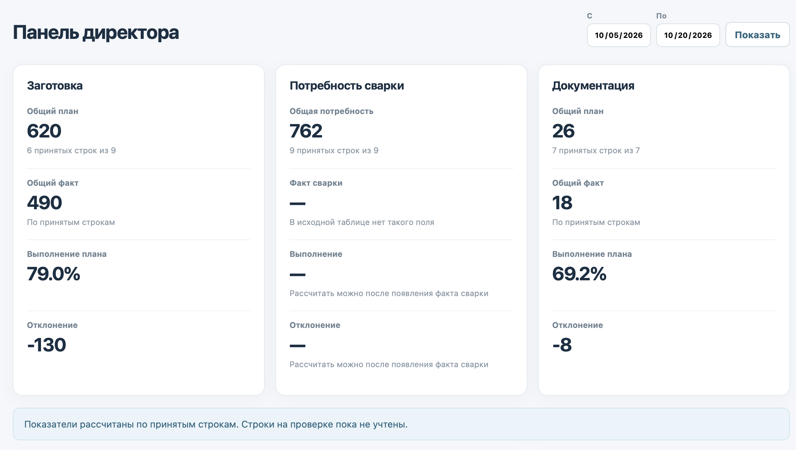
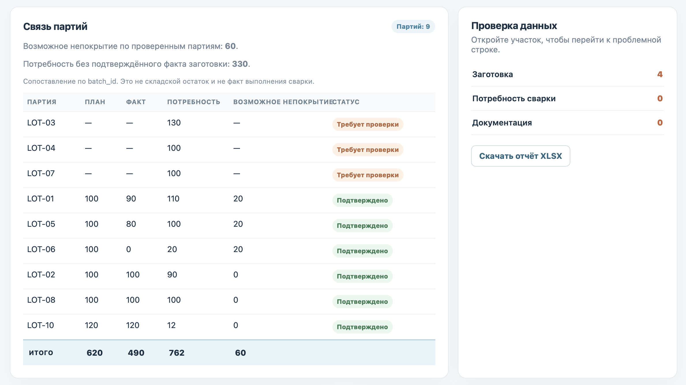
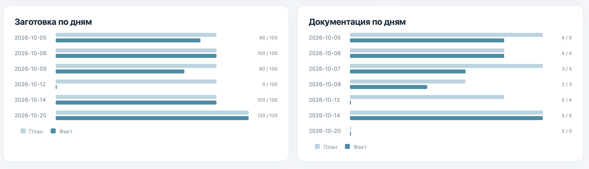
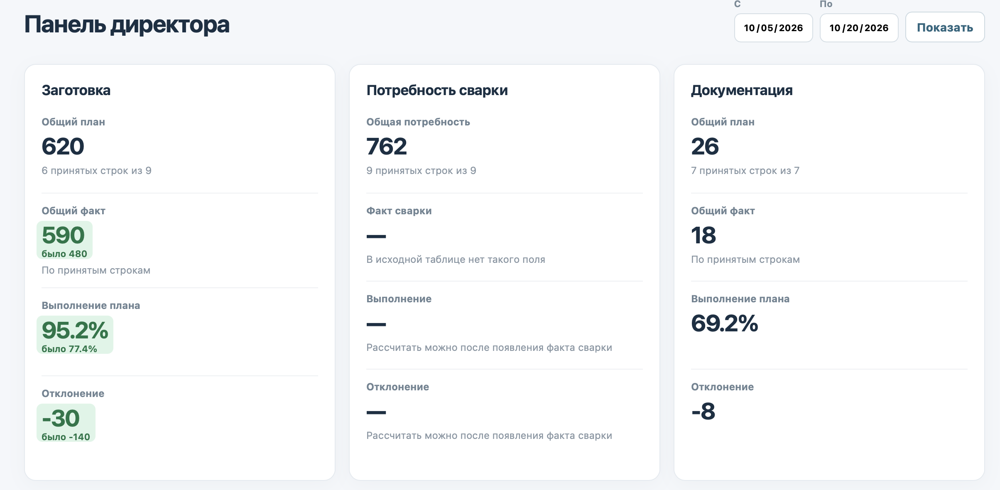
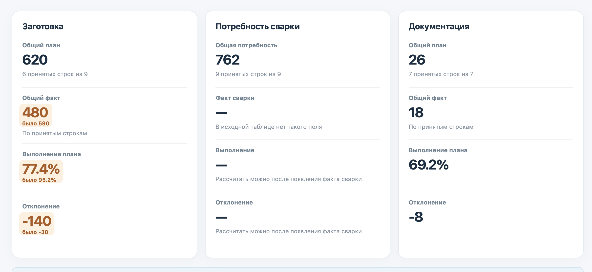
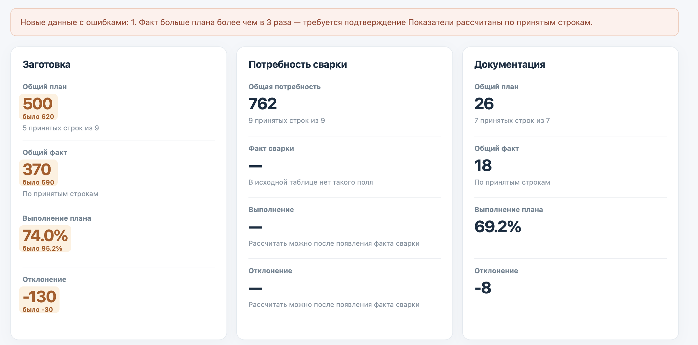
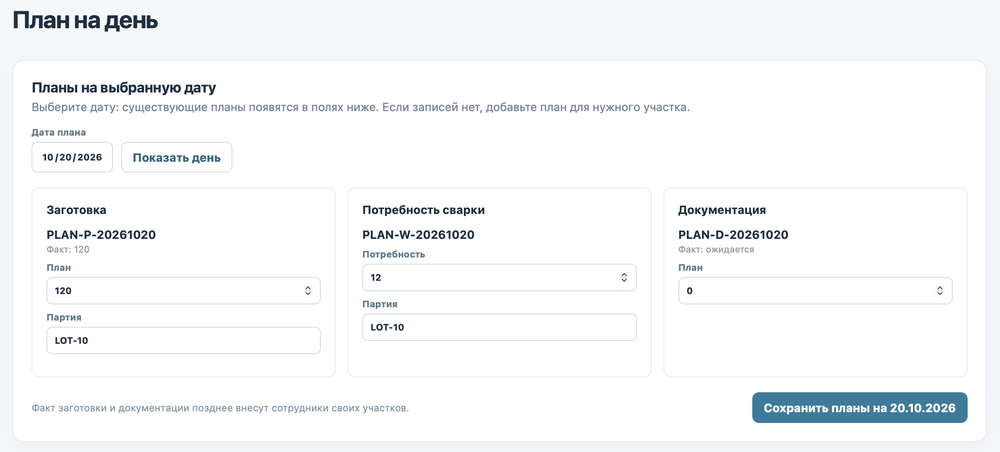
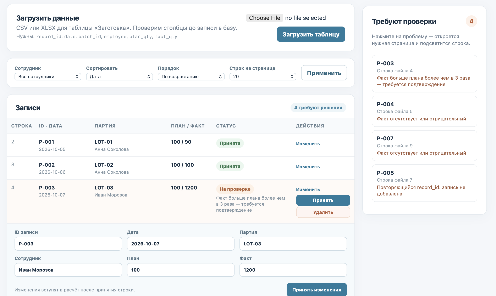
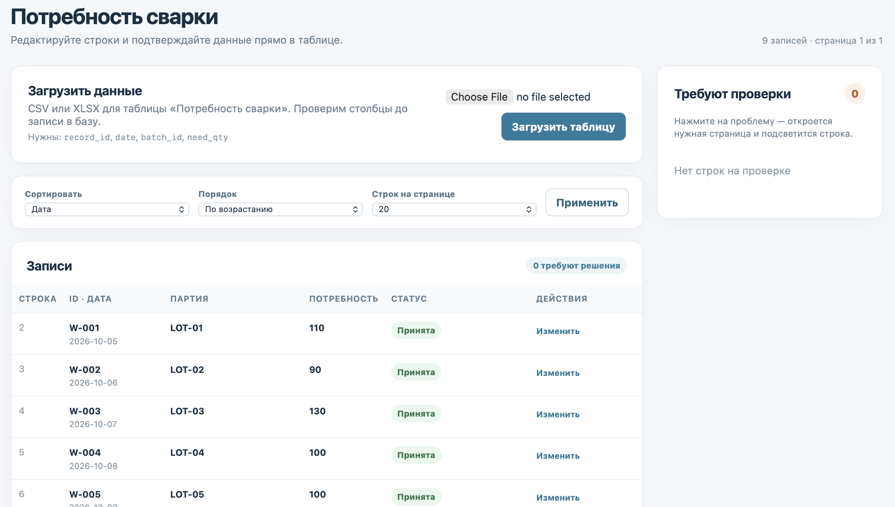
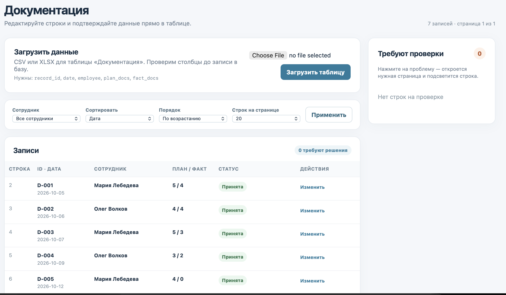

# Производство — альфа

## Стек технологий

- **Python 3.12+**, FastAPI и Jinja2 — сервер и страницы.
- **PostgreSQL** и `psycopg` — рабочие данные, пользователи и журнал изменений.
- **JavaScript и CSS** — таблицы и обновление панели без перезагрузки страницы.
- **openpyxl** — чтение и формирование XLSX; стандартный модуль `csv` — чтение CSV.
- **uv** и Uvicorn — зависимости и запуск.

## Запуск

Нужны Docker с запущенным контейнером PostgreSQL `postgres16` и установленный `uv`. Из корня проекта выполните:

```bash
./start.sh
```

Откройте [http://127.0.0.1:8501](http://127.0.0.1:8501). Скрипт создаёт отдельные роль и базу `mvp_task` в контейнере, устанавливает зависимости и запускает сервер. Пароль БД и ключ сессии сохраняются в локальном `.mvp.env`; повторный запуск не удаляет данные.

Если контейнер называется иначе, задайте `POSTGRES_CONTAINER`. Для готовой базы можно передать `DATABASE_URL`. Порты меняются через `POSTGRES_PORT` и `APP_PORT`.

### Запуск через Docker Compose

Для отдельного запуска приложения вместе с PostgreSQL выполните:

```bash
./start-compose.sh
```

Нужен работающий Docker. Скрипт проверит Docker Compose и, если его нет, спросит об установке (автоматическая установка предусмотрена для Ubuntu/Debian и macOS с Homebrew). Python и `uv` на компьютере для этого способа не нужны: зависимости устанавливаются внутри образа. Первый запуск создаёт локальный `.compose.env` со случайными паролями, выводит пароли директора и сотрудников в терминал и сохраняет данные PostgreSQL в Docker volume. Файл `.compose.env` не добавляется в Git.

По умолчанию приложение доступно только на `127.0.0.1:8501`. Для сервера при первом запуске задайте `APP_BIND_HOST=0.0.0.0 ./start-compose.sh`; при необходимости задайте также `APP_PORT`. Изменения сохраняются в `.compose.env`. Для остановки используйте `docker compose --env-file .compose.env down` — данные в volume сохранятся.

## Демо-вход

| Логин | Пароль | Доступ |
| --- | --- | --- |
| `director` | `director123` | Панель, планы на день, все три таблицы, загрузка, проверка, отчёт, очистка БД |
| `anna`, `ivan` | `staff123` | Просмотр и изменение факта в таблице заготовки |
| `maria`, `oleg` | `staff123` | Просмотр и изменение факта в таблице документации |

Пароли из таблицы действуют для запуска через `start.sh`. Их можно задать через `DIRECTOR_PASSWORD` и `STAFF_PASSWORD` **перед первым запуском**. При запуске через Docker Compose создаются случайные пароли в `.compose.env`. Повторный запуск не перезаписывает существующие учётные записи. Вход предназначен для альфа-версии.

В меню директора есть раздел «Очистить БД». После отдельного подтверждения он удаляет рабочие строки, загрузки, историю проверки и дополнительные учётные записи. Пять демо-пользователей сохраняются.

## Панель директора

Период задаётся датами «С» и «По»; для месячного обзора укажите первый и последний день месяца. Показатели рассчитываются по принятым строкам. Заготовка и документация показывают общий план, факт, выполнение и отклонение. У сварки пока есть только потребность: факта сварочных работ в исходной таблице нет.

Связь заготовки и потребности сварки строится по `batch_id`. «Возможное непокрытие» — `max(потребность − подтверждённый факт заготовки, 0)`, когда оба значения известны. Это не складской остаток. Документация к партиям не привязана.







### Обновление открытой панели

Панель проверяет новые изменения факта примерно каждые 2,5 секунды. Если дата изменения входит в выбранный период, показатели, связи партий и графики обновляются без перезагрузки. Изменившееся значение на 5 секунд подсвечивается и показывает прежнее значение. Правки за пределами периода не отображаются.





Если новый факт требует проверки, появляется плашка «Новые данные с ошибками». Такая строка не входит в показатели до принятия директором; предупреждение о непроверенных строках остаётся на панели.



## План на день

В разделе «План на день» директор выбирает дату и задаёт планы сразу для трёх участков. Если на дату уже есть строки, форма показывает их значения для изменения; если строк участка нет, можно добавить новую. Планы сохраняются в рабочих таблицах, отдельной таблицы месячных планов нет. Для новой заготовки и потребности сварки нужна партия. Факт заготовки и документации позже заполняет сотрудник.



## Рабочие таблицы

В каждой таблице доступны сортировка по дате, плану или потребности, статусу и, где поле существует, факту; направление выбирается отдельно. В заготовке и документации можно отфильтровать строки по сотруднику. Размер страницы — 10, 20, 50 или 100 строк. Справа находятся ссылки на проблемные строки, в том числе на других страницах таблицы.

Сотрудник меняет только факт в таблице своего участка. После сохранения его имя записывается в строку как имя последнего редактора. Директор может исправить и принять проблемную строку либо удалить её.







## Загрузка и проверка

1. Директор открывает нужную таблицу и загружает CSV или XLSX размером до **20 МБ**. Материалы находятся в `sample_data/`; приложение не импортирует их автоматически.
2. До импорта проверяются заголовки: если выбран файл другого участка, не хватает обязательных столбцов или имена повторяются, сообщение указывает конкретные столбцы. Имена заголовков сопоставляются без учёта регистра и пробелов по краям.
3. После импорта показываются числа принятых строк, строк на проверке и не добавленных строк. Повторная загрузка того же файла для того же участка не создаёт копий.
4. Проблемные строки доступны справа и в таблице. Ссылка ведёт к самой строке даже при другой странице пагинации. Директор может исправить и принять её; подозрительный факт заготовки можно принять без изменения. Принятые строки входят в расчёты, строки на проверке — нет.

| Поле или условие | Принимается сразу | Требует проверки | Не добавляется |
| --- | --- | --- | --- |
| `record_id` | Непустой и уникальный | — | Пустой или уже существующий ID |
| `date` | Корректная дата: `YYYY-MM-DD`, `DD.MM.YYYY`, `DD/MM/YYYY` или дата Excel | — | Некорректная или пустая дата |
| `batch_id` заготовки и сварки | Непустая партия | — | Пустая партия |
| `employee` заготовки и документации | Непустое имя | Пустое имя | — |
| План, факт, потребность | Целое число **от 0** | Пустое или отрицательное значение | Текст или дробное число |
| Факт заготовки при плане **больше 0** | Не превышает план более чем в 3 раза | Строго больше `3 × план` | — |

Ноль допустим. Порог `3 × план` действует только для заготовки и только при положительном плане. Пустой факт в строке, созданной директором через форму плана на день, означает ожидание сотрудника. Если строка уже отправлена на проверку, её план и факт исключаются из подтверждённых показателей.

**Обязательные столбцы файла:**

| Таблица | Названия столбцов |
| --- | --- |
| Заготовка | `record_id`, `date`, `batch_id`, `employee`, `plan_qty`, `fact_qty` |
| Потребность сварки | `record_id`, `date`, `batch_id`, `need_qty` |
| Документация | `record_id`, `date`, `employee`, `plan_docs`, `fact_docs` |
